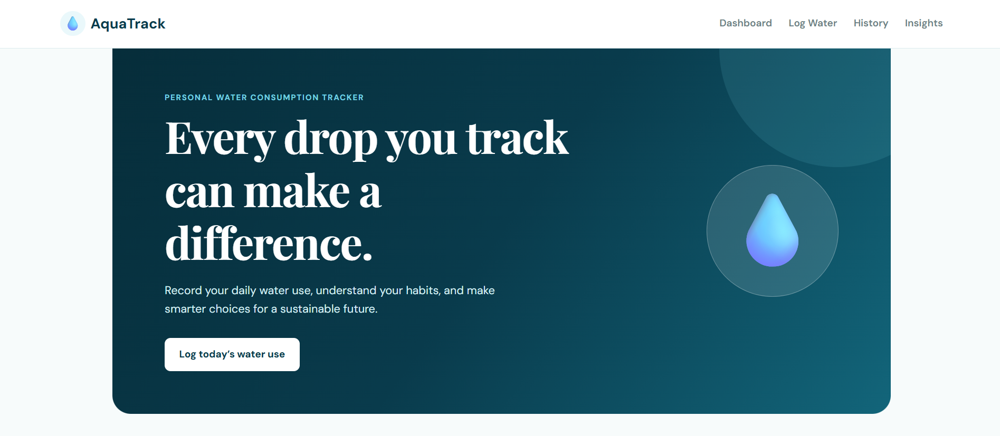
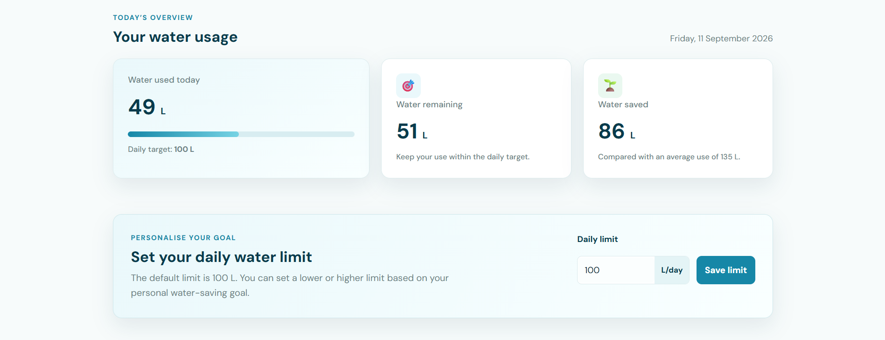
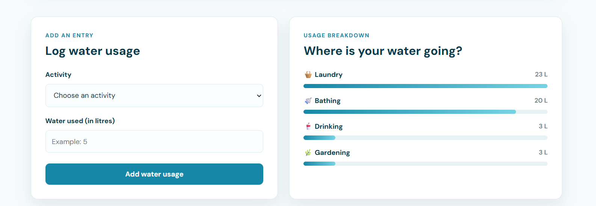
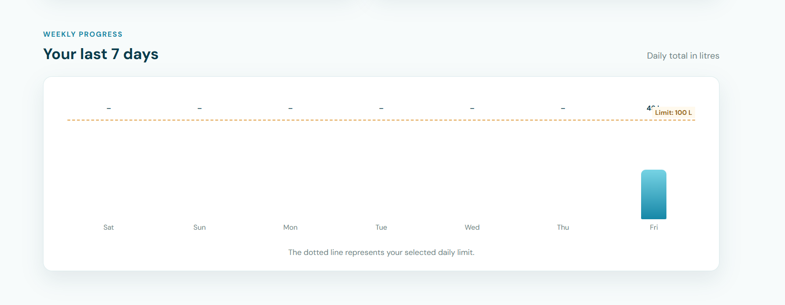
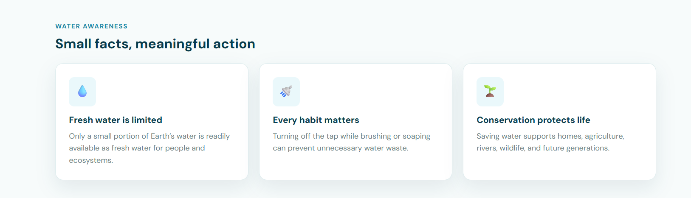

# AquaTrack — Personal Water Consumption Tracker

AquaTrack is a web-based Personal Water Consumption Tracker developed for the CHE110 Environmental Studies group assignment.

It helps users record daily water use, compare it with a personal water limit, understand high-consumption activities, and follow simple water-conservation habits.

## Features

- Log water consumption by activity
- Activities include bathing, drinking, laundry, dishwashing, cleaning, gardening, and other use
- Calculate total water consumed today
- Default daily water limit of 100 litres
- Users can set and save their own daily water limit
- Show water remaining before reaching the daily limit
- Show water saved compared with 135 L average usage
- Progress bar for daily water consumption
- Activity-wise water usage breakdown
- Personalised water-saving tips
- Delete individual water entries
- Clear all saved water records
- 7-day water-consumption history chart
- Water-awareness facts section
- Browser local storage saves data after refreshing the page
- Responsive layout for desktop and mobile devices

## Technologies Used

- HTML5
- CSS3
- JavaScript
- Browser Local Storage

## How to Run the Project

1. Download or clone this repository.
2. Open the project folder.
3. Open `index.html` in Google Chrome, Microsoft Edge, or another modern browser.
4. Start logging your daily water usage.

No installation, server, or database is required.

## Project Structure

```text
water-consumption-tracker/
├── index.html
├── css/
│   └── style.css
├── js/
│   └── app.js
├── assets/
│   └── screenshots/
│       ├── homepage.png
│       ├── dashboard.png
│       ├── usage-breakdown.png
│       ├── weekly-chart.png
│       └── water-facts.png
└── README.md
```
```

## Screenshots

### Homepage



### Dashboard



### Usage Breakdown



### Weekly History



### Water Awareness Facts



## Purpose

Fresh water is limited and daily habits can lead to unnecessary water waste. AquaTrack encourages users to observe their water consumption, identify areas where water can be saved, and make environmentally responsible choices.

## CHE110 Environmental Studies Project

**Topic:** Personal Water Consumption Tracker  
**Course:** CHE110 — Environmental Studies
